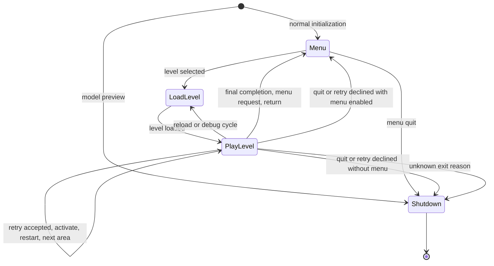

# Active architecture: Godot / C# / .NET

The current runtime architecture is documented in
[Godot migration](GODOT_MIGRATION.md). The recovered C++ architecture below is
retained as reference for the port. Its fixed-address and 32-bit compatibility
requirements are retired targets, not constraints on the managed game.

# Source architecture

The native game is being migrated from recovered executable code to explicit
systems. Binary layouts, packed assets, fixed-point arithmetic and original
entry points are compatibility contracts. Change behavior deliberately and
verify it with the game assets; a successful link alone is insufficient.

## Systems

| Directory | Responsibility |
| --- | --- |
| `src/core` | Fundamental types, fixed-point mathematics, heap and allocation contracts |
| `src/engine/rendering` | Scene projection, textures, animation decoding and render storage |
| `src/engine/assets` | Archives, files, resource loading and relocation |
| `src/engine/audio` | Music and sound playback orchestration |
| `src/engine/input` | Game input and controller interpretation |
| `src/engine/world` | Object lists, collision, spatial queries and trigger execution |
| `src/engine/persistence` | Saves and original memory-card interfaces |
| `src/game/application` | Startup, shutdown and the game loop |
| `src/game/player` | Player movement, animation, webs and weapons |
| `src/game/actors` | Enemies, allies and actor-specific behavior |
| `src/game/objects` | Interactive objects, platforms, pickups and doors |
| `src/game/effects` | Transient visual effects |
| `src/game/levels` | Level-specific scripts and training behavior |
| `src/game/ui` | Menus, HUD, fonts, messages and screen transitions |
| `src/game/cinematics` | Cameras, scripted scenes and movie orchestration |
| `src/compatibility` | Original entry points, layout validation and executable integration |
| `src/compatibility/directx` | Original aggregate entry points, codec helpers and layout integration |
| `src/third_party` | Bundled upstream headers; keep separate from game code |
| `platform` | OS and SDL backends, executable-data bootstrap, media decoder and launcher |

Every former root source/header has a new location. Look up an old filename in
[source_paths.json](source_paths.json). `cmake/GameSources.cmake` lists each
system's translation units explicitly; newly added game sources belong in that
list. CMake exposes `src` and the repository root as include roots. Use canonical
includes such as `"engine/rendering/render_buffer_pool.h"`.

The module lists describe the current organization, not yet a fully enforced
one-way dependency graph. Recovered headers still have cycles, and some engine
functions still consult game state. The migration must remove those dependencies
through small contracts rather than hide them in a global service locator.

## Class and dependency rules

New code lives in `spidey::core`, `spidey::rendering`, or an appropriate system
namespace. Use PascalCase types and camelCase methods, parameters and local
variables. Name values by their meaning and units: `outputWidth`, `byteCount`,
`animationFrame`, `worldPosition`, or `durationMilliseconds`.

Give classes one resource or behavior to manage. Use composition; introduce a
virtual interface only when consumers need a replaceable implementation. Inject
those dependencies explicitly. Resource owners must define creation, failure
cleanup and release, and disable copying where ownership cannot be duplicated.
Do not add singletons, broad utility bags or inheritance layers to meet a pattern
quota. Put mathematical operations and format conversions in their own modules.

`ViewportLayout` is a pure value object: it calculates menu/gameplay viewports,
horizontal field expansion and HUD translation from physical output pixels.
It has no SDL or OpenGL dependency. The backend applies the result.
`RenderBufferPool` owns the allocations used by the two original frame records.
It depends only on `MemoryAllocator`; `PersistentRenderAllocator` adapts the
original game heap. Existing `Db_*` entry points forward to that implementation.
`GameApplication` owns native startup ordering; `main_standalone.cpp` only sets
up process diagnostics, the launcher and the requested game directory. Named
math functions in `core/distance.h` express the original approximate 3D and
horizontal distance metrics; old exported function names remain adapters.
`ZipWebController` shares targeting and transition setup for both zip inputs;
`PlayerAnimationController` starts animation and sound scripts together. The
player's cached transform axes and interaction target have verified names
without any layout change.

`LevelSession` runs one loaded level. Its preparation, world update, drawing,
presentation and exit cleanup are separate methods; the `PlayAway` export is
an adapter. It borrows `FramePacer`, which depends on an injected `TickClock`.
The production clock uses display ticks; tests advance a controlled clock.
Normal gameplay waits for two 60 Hz ticks per frame, preserving the original
physics speed. The existing `SPIDEY_60FPS` opt-in waits for one tick.
`CBody::mLastUpdateTick`, `mElapsedTicks` and `mAccumulatedTicks` name the
shared actor timing values at offsets 0x7C, 0x80 and 0x84. Their signed types,
six-tick clamp and animation/movement consumers remain unchanged.

`GameFlow` owns the menu/load/play/shutdown state machine. `GameFlowActions`
supplies the effects of each transition; the production adapter invokes the
existing menu, level, save and cinematic systems. The original `SpideyMain`
export delegates to it. Retry rejection chooses a destination without repeating
the cleanup already performed for the retry prompt. Menu requests persist
through forced level selection and are consumed when the shell is shown.
`LevelExitReason` names the original numeric codes without changing trigger
storage or exports.



The original `SSaveGame` record lives in `engine/persistence/save_game_state.h`
and depends only on core types. Menus include it instead of defining persistence
data. Its level name and completion counters have verified names; remaining
opaque fields retain their original offsets and recovery notes.

`ActorListUpdater` handles active and suspended actor lists: deferred deletion,
distance-based suspension, timing, skeletal animation, AI and shadow updates.
It borrows the suspension threshold so trigger changes remain visible during a
pass. `visitIntrusiveList` saves each next link before a callback can remove or
move its current node; new head insertions wait for the next pass. It borrows
the visitor so stateful callbacks retain their results. Callbacks must preserve
the saved next node. `InputUpdateTrace` is an optional observer in the application
module, keeping input diagnostics out of the world updater. Original Ob_ entry
points remain compatibility adapters; actor layouts have no added members.

`WorldSimulation` owns gameplay frame phases: debug stepping, input/timing,
active-world updates, pending triggers and UI, and camera-mode selection. The
original `Logic` export delegates to it. Camera AI is exposed separately and
called from the display phase, preserving its timing relative to rendering.
Frozen worlds skip actor/effect updates but continue servicing triggers and UI;
input-only debug modes skip all gameplay phases and counter increments.
`PlayerFrameTrace` keeps optional diagnostic formatting out of gameplay code
and reads environmental objects through verified CItem fields rather than raw
byte offsets. Remaining player diagnostic offset labels are retained for oracle
comparison; this is developer logging, not a player-facing interface.

`GameplayRenderer` composes camera preparation, HUD submission, world setup,
texture effects, world messages, actor models and final overlays. The original
`Display` export delegates to it. Render-list switches have named indices while
retaining the original ten-entry storage. Special actor drawing and primitive/
buffer accounting are separate methods. Gameplay/HUD coordinates are enabled
before fades and panel graphics are queued; HUD mode is restored before world
setup. Music updates, post effects, particles and final overlays retain their
original ordering. Presentation stays in `LevelSession`. `BaddyFrameTrace` owns
optional enemy diagnostics and samples every thirty display frames.

`ScriptedInputController` borrows the player and owns the scripted-input update
algorithm: input preparation, due instruction decoding, concurrent commands,
input publication and completion. Teleport handling is separate from decoding.
The original `SynthesizeAnalogueInput` export delegates to it. Verified script
fields now name the checkpoint, active-input flag, elapsed ticks, decoding flag,
encoded cursor and command-list head. All original offsets and record sizes
remain unchanged; the fixed-address adapters and unknown fields remain explicit.
Animation holders use `PlayerAnimationController` to keep animation and sound
script setup together. [Scripted player input](SCRIPTED_PLAYER_INPUT.md) documents
the bytecode and timer contracts. Twenty-register button access is centralized;
Start/Select retain physical control and command-owned input is published after
all commands run.

`ScriptCommandList` shares command allocation, unlinking, removal by type and
cleanup across the player, Black Cat and Spider-Man clone. It borrows the actor's
original list head and a `MemoryAllocator`; short-lived adapters never clear the
list on destruction. A separate game-heap allocator supplies production policy.
`ScriptCommandView` centralizes the encoded 32-bit link, length, type and
parameters. The scripted-input controller creates typed records and uses this
view rather than decoding headers or links itself. New records have their
length initialized before linking. Failed allocation leaves the list intact,
and removal by type advances before freeing the current record. Actor layouts
and exported member entry points remain unchanged.

`ActorScriptController` shares the verified Black Cat/Spider-Man clone bytecode
algorithm. A borrowed `ActorScriptState` maps each original actor's fields without
changing its layout; a value `ActorScriptProfile` preserves walking speed,
animation ids, movement scaling and the correct animation-signal source.
Checkpoint state is optional, so the clone's gravity field cannot be mistaken
for Black Cat's checkpoint. Preparation, instruction decoding, concurrent
commands and completion are separate phases. Original actor entry points remain
adapters. [Actor script bytecode](ACTOR_SCRIPT_BYTECODE.md) documents the policy
differences and the real-actor regression's scope.

`ActorMotionIntegrator` advances borrowed motion records independently of actor
classes. Its two-tick and fixed-timestep methods retain the distinct Black Cat
and clone timing policies. Original DoPhysics methods are small adapters;
verified gravity and elapsed-history fields are named without layout changes.
`wrapping_math.h` centralizes original 32/16-bit arithmetic and x86 shift behavior
without signed overflow or invalid scalar-to-vector casts. [Actor motion](ACTOR_MOTION.md)
documents rounding/order contracts and a 4,000-case comparison against actual
original executable instructions, passing under GCC, Clang and sanitizers.

`fixed_vector` now contains independently linkable arithmetic. Its headers
include core types rather than executable globals. Integer overflow, short
narrowing and variable shifts use defined original-word operations. Game code
uses explicit scalars; the original vector-by-vector broadcast symbol, GTE
length calculations and hook registrations remain in the compatibility bridge.
[Fixed vectors](FIXED_VECTOR.md) describes the contracts and 100,000-result
original-instruction oracle.

`SwingArc` expresses web-swing geometry, phase and animation policy.
`SwingCollisionResolver` borrows player state and a world-probe interface,
keeping collision order and surface response independent of game globals.
`DoSwingingPhysics` is an adapter that samples hooks around a typed swing
position update. `CSwinger` shares axis extraction and web-line synchronization.
[Player swing](PLAYER_SWING.md) records original behavior, 10,000 instruction
comparisons and the real-object/world-probe regression.

`CrawlPhysicsController` separates surface movement, corner probes, surface
recovery/response, control transitions and platform notification. `CrawlMotion`
contains the arithmetic policy; `CrawlFrameTrace` owns optional diagnostics.
The original player entry point delegates to the controller, with verified
flags/distances/support state now named. [Player crawl](PLAYER_CRAWL.md) records
branch ordering, 10,000 original movement comparisons and real-world probe tests.

`PlayerPhysicsController` orchestrates ordinary ground/air movement, arena
constraints, sweeps, vertical travel and landing response. `PlayerMotion` shares
integer integration with crawling; `SweepGeometry` and `GroundProbeFan` express
query geometry. Fixed-address policy reads remain at the original export adapter.
A no-sweep update now has an explicit null hit pointer, fixing an undefined read.
[Player physics](PLAYER_PHYSICS.md) explains those phases, the original-instruction
comparisons and real-level regression scope.

`PlayerBehaviorController` separates frame preparation, animation follow-ons,
action routing and shared finalization. `PlayerAction` names the original action
words; 31 handlers preserve local exits and the common frame work. `SpideyAI0`
remains an export adapter. `PlayerFrameFinalizer` owns 16 shared steps; camera
and presentation implementations are separate, with explicit cached heading,
query storage and hand-hook values passed between phases. `PlayerFramePreparation`
owns 15 pre-action steps; status and analog/lookaround code are separate. The
suspension gate preserves its position after timers/effects and before physics.
Fixed-address dependencies live in the compatibility
bridge while handler internals continue to be migrated.
[Player behavior](PLAYER_BEHAVIOR.md) documents phase order and regression limits.
Action methods are grouped into movement, web, combat and interaction files.
`LocomotionAnimationPolicy` separates fall-reference reset, animation selection
and pending-release consumption; reverse-movement selection is shared there too.
[Locomotion animation](LOCOMOTION_ANIMATION.md) records 2,097,152 comparisons
against the original decision instructions and the actual falling regression.

`ButtonState` models the four buffered input states; device polling converts
platform snapshots through it. `PolygonPacket` and `ScreenVertex` name the
original queue/vertex records without changing their binary stride.
`PolygonQueue` borrows the original bucket array and centralizes insertion,
reset and traversal. Depth buckets remain descending, with the last submission
first inside a bucket. Input, sound channels and rendering have separate
headers; `DXsound.h` is now only an aggregate compatibility include.

## Compatibility rules

Keep recovered class sizes, member offsets, virtual method ordering, packed
formats, 32-bit addresses and calling conventions until their consumers have
been migrated together. Adding a member or virtual destructor to an original
class can break model decoding or original asset interpretation.

Preserve original exported names when they are needed by compatibility builds
or binary comparison tools. Use a clear class behind the adapter rather than
rename an export and silently break that contract. `field_XXX` denotes a member
whose semantic meaning is not established yet. Replace it with a meaningful
name only after checking every read/write, the original implementation and a
runtime scenario. Guessing names conceals uncertainty.

The standalone executable still loads initialized data from the user's original
executable. `platform/exemem*` and the linker script implement this constraint.
Removing these addresses is a separate migration of each data owner, not a
pointer search-and-replace.

## Verification

Configure any normal CMake build, then run:

```sh
cmake --build out-sa -j8
ctest --test-dir out-sa --output-on-failure
```

The unit tests exercise display geometry, render allocation rollback, fixed-
point distance metrics, buffered button transitions, device polling and polygon
queue ordering. The frame-pacer test verifies minimum frame time, slow frames
and tick rollover. Game-flow tests cover accepted/declined retries, reloads,
debug cycling, activation, completion, forced selection, menu notifications,
model preview and shutdown, including the order of their effects.
Intrusive-list tests cover empty lists, link reuse, self-deletion, head insertion
and stateful callbacks; they also pass address/undefined-behavior sanitizers.
Both GCC and Clang compile the source and pass native layout validation using
standard C++ inline definitions. Out-of-line definitions belong in source
files; header-defined helpers use ordinary `inline`.
Platform pixel tests cover real OpenGL output, HUD anchoring and the return to
4:3 menus; see `tests/platform/README.md`. Asset-backed runtime checks cover
animation data remaining immutable during rendering; see
`tests/runtime/README.md`. Keep successful gameplay checks as evidence alongside
layout validation and headless builds.

## Remaining migration

The directory reorganization is complete. Behavior migration is in progress:
most actor, player, trigger and asset code still uses recovered classes and
names. The current source tree must not be described as a completed semantic
rewrite. Next work is to move player/trigger behavior behind named interfaces,
replace the remaining procedural renderer/audio state, migrate verified globals
into system-owned state, and clean the remaining recovered implementations
while preserving playable behavior.
